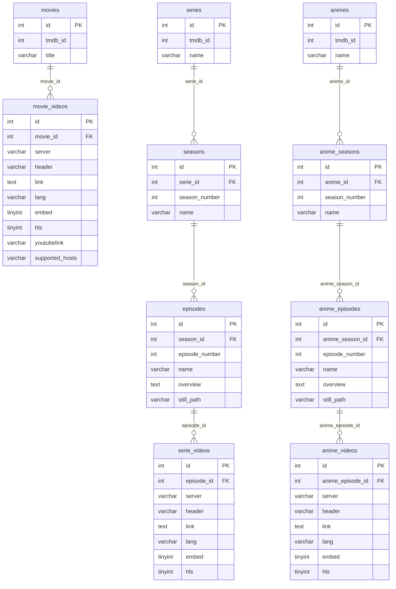

# Especificación Técnica y Contexto para IA: Web de Streaming con Base de Datos Dooplex

> **Instrucciones de uso:** Puedes entregar este archivo `.md` directamente a cualquier Inteligencia Artificial (Claude, ChatGPT, Cursor, Bolt, Lovable, v0, etc.) para que construya automáticamente una plataforma web completa donde navegar el catálogo y reproducir las películas, series y animes de **Dooplex**.

---

## 1. Prompt Inicial para la IA (Contexto del Proyecto)

```text
Actúa como un desarrollador Full-Stack Senior. Quiero que crees una aplicación web moderna de streaming (estilo Netflix / Cuevana / Dooplex) para ver el catálogo de Películas, Series y Animes almacenados en mi base de datos MySQL "Dooplex", y reproducir sus videos directamente en la web.

Utiliza toda la especificación técnica de este documento (credenciales de base de datos, estructura de tablas, endpoints REST actuales y lógica de reproducción de servidores de video) para construir tanto el backend/API de catálogo como el frontend con reproductor integrado.
```

---

## 2. Credenciales de Conexión a la Base de Datos (MySQL)

Los datos de conexión se configuran mediante variables de entorno (`.env.local`) o desde el instalador web (`/setup`):

| Parámetro | Valor | Notas |
| :--- | :--- | :--- |
| **Motor / Driver** | `mysql` | PDO / MySQLi / mysql2 |
| **Host (Desde el mismo hosting)** | `localhost` | Usar si los archivos PHP/Node corren en el mismo servidor |
| **Host (Conexión remota)** | `tu_host_mysql.com` | Host remoto del servidor MySQL |
| **Puerto** | `3306` | Puerto estándar MySQL |
| **Base de Datos (`DB_DATABASE`)** | `tu_base_de_datos` | Base de datos principal de Dooplex |
| **Usuario (`DB_USERNAME`)** | `tu_usuario_mysql` | Usuario con permisos de lectura/escritura |
| **Contraseña (`DB_PASSWORD`)** | `tu_password_mysql` | Contraseña de la base de datos |
| **Charset** | `utf8mb4` | Codificación recomendada |
| **Collation** | `utf8mb4_unicode_ci` | Colación recomendada |

### Variables de Entorno (`.env`)

```env
# Conexión Base de Datos Dooplex
DB_CONNECTION=mysql
DB_HOST=tu_host_mysql.com
# Si se aloja en el mismo servidor cPanel/hosting usar: DB_HOST=localhost
DB_PORT=3306
DB_DATABASE=tu_base_de_datos
DB_USERNAME=tu_usuario_mysql
DB_PASSWORD="tu_password_mysql"
DB_CHARSET=utf8mb4

# URL Base de las APIs PHP actuales
PUBLIC_API_BASE_URL=https://tu-dominio.com
```

### Ejemplo de Conexión en PHP (PDO)

```php
<?php
$host = getenv('DB_HOST') ?: 'localhost';
$port = 3306;
$dbname = getenv('DB_DATABASE') ?: 'tu_base_de_datos';
$username = getenv('DB_USERNAME') ?: 'tu_usuario_mysql';
$password = getenv('DB_PASSWORD') ?: 'tu_password_mysql';
$charset = 'utf8mb4';

$dsn = "mysql:host={$host};port={$port};dbname={$dbname};charset={$charset}";
$pdo = new PDO($dsn, $username, $password, [
    PDO::ATTR_ERRMODE => PDO::ERRMODE_EXCEPTION,
    PDO::ATTR_DEFAULT_FETCH_MODE => PDO::FETCH_ASSOC,
]);
```

### Ejemplo de Conexión en Node.js (`mysql2/promise`)

```javascript
import mysql from 'mysql2/promise';

export const pool = mysql.createPool({
  host: process.env.DB_HOST,
  port: Number(process.env.DB_PORT) || 3306,
  user: process.env.DB_USERNAME,
  password: process.env.DB_PASSWORD,
  database: process.env.DB_DATABASE,
  charset: 'utf8mb4',
  waitForConnections: true,
  connectionLimit: 10,
});
```

---

## 3. Esquema de Tablas de la Base de Datos (Dooplex)

La base de datos de Dooplex está organizada en **3 módulos de contenido** (Películas, Series y Animes) más la tabla de **Usuarios**.

### 3.1. Módulo de Películas (`movies` y `movie_videos`)

#### Tabla: `movies`
Almacena la información principal de cada película.
- `id` (`INT`, Primary Key) — ID interno de la película.
- `tmdb_id` (`INT` / `VARCHAR`) — ID de The Movie Database (TMDB).
- `title` (`VARCHAR`) — Título de la película.
- *(Nota: Al ser esquema Dooplex/EasyPlex, puede incluir columnas adicionales de TMDB como `poster_path`, `backdrop_path`, `overview`, `release_date`, `vote_average`, `created_at`, `updated_at`. Se recomienda hacer `SELECT * FROM movies LIMIT 1` o usar el `tmdb_id` con la API/imágenes de TMDB).*

#### Tabla: `movie_videos`
Almacena los enlaces de streaming/servidores para cada película.
- `id` (`INT`, Primary Key, Auto-increment)
- `movie_id` (`INT`, Foreign Key -> `movies.id`) — Relación con la película.
- `server` (`VARCHAR`) — Nombre del servidor (ej. `StreamWish`, `Doodstream`, `SuperVideo`, `EarnVids`, `Byse.sx`, `VOE`, `Uqload`, `Vidara`, `HLS`, `Directo`, etc.).
- `header` (`VARCHAR`) — Encabezado o etiqueta secundaria del servidor.
- `link` (`TEXT` / `VARCHAR`) — **URL del video** (enlace embed, `.m3u8`, `.mp4`, etc.).
- `lang` (`VARCHAR`) — Idioma del video (`LAT` / `Latino`, `CAST` / `Castellano`, `SUB` / `Subtitulado`).
- `embed` (`TINYINT` / `INT`) — `1` si es un enlace para incrustar en `<iframe>`, `0` en caso contrario.
- `youtubelink` (`TINYINT` / `VARCHAR`) — `1` si es un video de YouTube, `0` o vacío si no.
- `hls` (`TINYINT` / `INT`) — `1` si es un stream HLS (`.m3u8`), `0` si no.
- `supported_hosts` (`TINYINT` / `TEXT`) — `1` si requiere extractor o host soportado.
- `created_at` (`DATETIME` / `TIMESTAMP`)
- `updated_at` (`DATETIME` / `TIMESTAMP`)

---

### 3.2. Módulo de Series (`series`, `seasons`, `episodes`, `serie_videos`)

#### Tabla: `series`
- `id` (`INT`, Primary Key) — ID interno de la serie.
- `tmdb_id` (`INT` / `VARCHAR`) — ID de TMDB de la serie.
- `name` (`VARCHAR`) — Título/nombre de la serie.

#### Tabla: `seasons`
- `id` (`INT`, Primary Key) — ID interno de la temporada.
- `serie_id` (`INT`, Foreign Key -> `series.id`) — ID de la serie a la que pertenece.
- `season_number` (`INT`) — Número de la temporada (`1`, `2`, `3`...).
- `name` (`VARCHAR`) — Nombre de la temporada (ej. `Temporada 1`).

#### Tabla: `episodes`
- `id` (`INT`, Primary Key) — ID interno del episodio.
- `season_id` (`INT`, Foreign Key -> `seasons.id`) — ID de la temporada a la que pertenece.
- `episode_number` (`INT`) — Número del episodio dentro de la temporada (`1`, `2`, `3`...).
- `name` (`VARCHAR`) — Título del episodio.
- `overview` (`TEXT`, opcional) — Sinopsis del episodio.
- `still_path` (`VARCHAR`, opcional) — Miniatura horizontal del episodio.
- `still_path_tv` (`VARCHAR`, opcional) — Miniatura para TV.

#### Tabla: `serie_videos`
Almacena los enlaces de video de cada episodio de serie.
- `id` (`INT`, Primary Key, Auto-increment)
- `episode_id` (`INT`, Foreign Key -> `episodes.id`) — Relación con el episodio.
- `server` (`VARCHAR`) — Nombre del servidor.
- `header` (`VARCHAR`) — Encabezado/etiqueta.
- `link` (`TEXT` / `VARCHAR`) — **URL del video**.
- `lang` (`VARCHAR`) — Idioma (`LAT`, `CAST`, `SUB`).
- `embed` (`TINYINT` / `INT`) — `1` si es iframe embed.
- `youtubelink` (`TINYINT` / `VARCHAR`)
- `hls` (`TINYINT` / `INT`) — `1` si es HLS (`.m3u8`).
- `supported_hosts` (`TINYINT` / `TEXT`)
- `created_at` (`DATETIME`)
- `updated_at` (`DATETIME`)

---

### 3.3. Módulo de Animes (`animes`, `anime_seasons`, `anime_episodes`, `anime_videos`)

#### Tabla: `animes`
- `id` (`INT`, Primary Key) — ID interno del anime.
- `tmdb_id` (`INT` / `VARCHAR`) — ID de TMDB del anime.
- `name` (`VARCHAR`) — Nombre del anime.

#### Tabla: `anime_seasons`
- `id` (`INT`, Primary Key) — ID interno de la temporada de anime.
- `anime_id` (`INT`, Foreign Key -> `animes.id`) — Relación con la tabla `animes`.
- `season_number` (`INT`) — Número de temporada.
- `name` (`VARCHAR`) — Nombre de la temporada.

#### Tabla: `anime_episodes`
- `id` (`INT`, Primary Key) — ID interno del episodio de anime.
- `anime_season_id` (`INT`, Foreign Key -> `anime_seasons.id`) — Relación con `anime_seasons`.
- `episode_number` (`INT`) — Número del episodio.
- `name` (`VARCHAR`) — Nombre del episodio.
- `overview` (`TEXT`, opcional) — Sinopsis del episodio.
- `still_path` (`VARCHAR`, opcional) — Imagen del episodio.
- `still_path_tv` (`VARCHAR`, opcional) — Imagen TV del episodio.

#### Tabla: `anime_videos`
Almacena los enlaces de video de cada episodio de anime.
- `id` (`INT`, Primary Key, Auto-increment)
- `anime_episode_id` (`INT`, Foreign Key -> `anime_episodes.id`) — Relación con el episodio de anime.
- `server` (`VARCHAR`) — Servidor de video.
- `header` (`VARCHAR`) — Encabezado.
- `link` (`TEXT` / `VARCHAR`) — **URL del video**.
- `lang` (`VARCHAR`) — Idioma (`LAT`, `CAST`, `SUB`).
- `embed` (`TINYINT` / `INT`)
- `youtubelink` (`TINYINT` / `VARCHAR`)
- `hls` (`TINYINT` / `INT`)
- `supported_hosts` (`TINYINT` / `TEXT`)
- `created_at` (`DATETIME`)
- `updated_at` (`DATETIME`)

---

### 3.4. Tabla de Usuarios (`users`)
- `id` (`INT`, Primary Key)
- `name` o `username` (`VARCHAR`)
- `email` (`VARCHAR`)
- `password` (`VARCHAR`) — Hash `bcrypt` (`$2y$...`), con soporte fallback a `MD5` o texto plano.
- `role` (`VARCHAR`) — Rol del usuario (ej. `admin`).

---

### Diagrama Entidad-Relación (Mermaid)



---

## 4. Endpoints REST Ya Desplegados (`https://app.movflix.live`)

Si prefieres no conectar directamente a MySQL desde el frontend, ya existen estos endpoints PHP con CORS habilitado (`Access-Control-Allow-Origin: *`) en `https://app.movflix.live`:

### 4.1. Estadísticas Generales
- **GET** `https://app.movflix.live/dashboard.php`
  - Respuesta: `{ "success": true, "data": { "dooplex": { "movies": 300, "series": 90, "animes": 40 } } }`

### 4.2. Autenticación
- **POST** `https://app.movflix.live/login_dooplex.php`
  - Body JSON: `{ "email": "usuario@correo.com", "password": "tu_password" }`
  - Respuesta: `{ "success": true, "message": "Login correcto", "data": { "username": "Admin", "role": "admin" } }`

### 4.3. Películas (`movie_dooplex.php`)
1. **Buscar película por TMDB ID:**
   - **GET** `https://app.movflix.live/movie_dooplex.php?tmdb_id={tmdb_id}`
   - Respuesta: `{ "data": [{ "id": 1, "title": "Nombre de la película" }] }`
2. **Obtener enlaces de video de una película:**
   - **GET** `https://app.movflix.live/movie_dooplex.php?movie_id={movie_id}`
   - Respuesta:
     ```json
     {
       "data": [
         {
           "id": 5,
           "server": "StreamWish",
           "header": "StreamWish",
           "link": "https://streamwish.fun/e/xxxxx",
           "lang": "LAT",
           "embed": 1,
           "youtubelink": "0",
           "hls": 0,
           "supported_hosts": "0"
         }
       ]
     }
     ```

### 4.4. Series (`series_dooplex.php`)
1. **Buscar serie por TMDB ID:**
   - **GET** `https://app.movflix.live/series_dooplex.php?tmdb_id={tmdb_id}`
   - Respuesta: `{ "data": [{ "id": 1, "name": "Nombre de la Serie" }] }`
2. **Obtener temporadas de una serie:**
   - **GET** `https://app.movflix.live/series_dooplex.php?serie_id={serie_id}`
   - Respuesta: `{ "data": [{ "id": 10, "season_number": 1, "name": "Temporada 1" }] }`
3. **Obtener episodios de una temporada:**
   - **GET** `https://app.movflix.live/series_dooplex.php?season_id={season_id}`
   - Respuesta: `{ "data": [{ "id": 25, "episode_number": 1, "name": "Episodio 1" }] }`
4. **Obtener enlaces de video de un episodio:**
   - **GET** `https://app.movflix.live/series_dooplex.php?episode_id={episode_id}`
   - Respuesta: `{ "data": [{ "id": 85, "server": "SuperVideo", "header": "SuperVideo", "link": "https://...", "lang": "LAT", "embed": 1, "youtubelink": "0", "hls": 0, "supported_hosts": "0" }] }`

### 4.5. Animes (`anime_dooplex.php`)
1. **Buscar anime por TMDB ID:**
   - **GET** `https://app.movflix.live/anime_dooplex.php?tmdb_id={tmdb_id}`
   - Respuesta: `{ "data": [{ "id": 1, "name": "Nombre del Anime" }] }`
2. **Obtener temporadas del anime:**
   - **GET** `https://app.movflix.live/anime_dooplex.php?anime_id={anime_id}`
   - Respuesta: `{ "data": [{ "id": 1, "anime_id": 1, "season_number": 1, "name": "Temporada 1" }] }`
3. **Obtener episodios de la temporada:**
   - **GET** `https://app.movflix.live/anime_dooplex.php?anime_season_id={anime_season_id}`
   - Respuesta: `{ "data": [{ "id": 10, "episode_number": 1, "name": "Episodio 1" }] }`
4. **Obtener enlaces de video del episodio de anime:**
   - **GET** `https://app.movflix.live/anime_dooplex.php?anime_episode_id={anime_episode_id}`
   - Respuesta: `{ "data": [{ "id": 5, "anime_episode_id": 10, "server": "StreamWish", "header": "StreamWish", "link": "https://...", "lang": "SUB", "embed": 1, "youtubelink": "0", "hls": 0, "supported_hosts": "0" }] }`

---

## 5. Endpoint Sugerido para Listar y Buscar Catálogo Completo (`catalog_dooplex.php`)

Dado que los endpoints actuales buscan principalmente por `tmdb_id`, la IA puede crear este endpoint PHP (o equivalente en Node.js / Next.js API Routes) conectado a `db_dooplex/Database.php` para listar películas, series y animes con **paginación y búsqueda por título**:

```php
<?php
header('Content-Type: application/json');
header("Access-Control-Allow-Origin: *");
require_once __DIR__ . '/db_dooplex/Database.php';

$db = new DooplexDatabase();
$conn = $db->connect();

$type = $_GET['type'] ?? 'movies'; // 'movies' | 'series' | 'animes'
$page = max(1, (int)($_GET['page'] ?? 1));
$limit = min(50, max(1, (int)($_GET['limit'] ?? 24)));
$offset = ($page - 1) * $limit;
$search = trim($_GET['q'] ?? '');

$tableMap = [
    'movies' => ['table' => 'movies', 'title_col' => 'title'],
    'series' => ['table' => 'series', 'title_col' => 'name'],
    'animes' => ['table' => 'animes', 'title_col' => 'name'],
];

if (!isset($tableMap[$type])) {
    http_response_code(400);
    echo json_encode(['error' => 'Tipo inválido']);
    exit;
}

$table = $tableMap[$type]['table'];
$titleCol = $tableMap[$type]['title_col'];

$where = '';
$params = [];
if ($search !== '') {
    $where = "WHERE {$titleCol} LIKE :search OR tmdb_id = :exact_tmdb";
    $params[':search'] = "%{$search}%";
    $params[':exact_tmdb'] = $search;
}

$stmt = $conn->prepare("SELECT * FROM {$table} {$where} ORDER BY id DESC LIMIT :limit OFFSET :offset");
foreach ($params as $k => $v) {
    $stmt->bindValue($k, $v);
}
$stmt->bindValue(':limit', $limit, PDO::PARAM_INT);
$stmt->bindValue(':offset', $offset, PDO::PARAM_INT);
$stmt->execute();

echo json_encode([
    'page' => $page,
    'limit' => $limit,
    'data' => $stmt->fetchAll(PDO::FETCH_ASSOC)
]);
```

---

## 6. Lógica para el Reproductor de Video en la Web

Para que la IA construya correctamente el reproductor de video en el frontend, debe tener en cuenta cómo se guardan los enlaces en `movie_videos`, `serie_videos` y `anime_videos`:

### 6.1. Clasificación de Servidores y Tipos de Enlace

Los servidores registrados comúnmente en el sistema son:
- **Servidores Embed (`<iframe>`)**: `SuperVideo`, `EarnVids`, `Doodstream`, `StreamWish`, `Byse.sx`, `VOE`, `Uqload`, `MixDrop`, `DropLoad`, `Player4Me`, `Streamtape`, `Vidsonic`, `Vidara`, `Solidfiles`, `OK.ru`, `HXFile`, `Vidmoly`, `LuluStream`.
- **Streams Directos / HLS**: `HLS` (archivos `.m3u8`), `Directo` (archivos `.mp4`, `.mkv`).
- **YouTube**: `YouTube` (`youtubelink = 1`).

### 6.2. Reglas de Renderizado del Reproductor

1. **Si `hls == 1` o `link` termina en `.m3u8`**:
   - Renderizar un reproductor `<video>` en HTML5 conectado con la librería `hls.js` (o reproducción nativa en Safari).
2. **Si `link` termina en `.mp4` o `.mkv` (y `embed == 0`)**:
   - Renderizar un reproductor `<video controls autoplay className="w-full aspect-video">`.
3. **Si `youtubelink == 1` o el link pertenece a `youtube.com` / `youtu.be`**:
   - Transformar a formato `https://www.youtube.com/embed/{VIDEO_ID}` y renderizar en `<iframe>`.
4. **Regla especial para Servidor `Vidara` (Stream Directo HLS + Thumbnail)**:
   - Cuando el enlace pertenece a **Vidara** (`vidara.so`, `vidara.to`, `vidaraa.cc`), se extrae el `filecode` del enlace (ej. `https://vidara.so/v/bqNlDdazNYOEt` -> `bqNlDdazNYOEt`) y se realiza una petición **POST** desde el backend a `https://vidara.so/api/stream`:
     ```json
     {
       "filecode": "bqNlDdazNYOEt",
       "device": "web",
       "codecs": ["av1"]
     }
     ```
   - La respuesta JSON entrega:
     - `thumbnail`: URL de la imagen previa para mostrar en la portada del reproductor antes de darle Play (`https://m696yefd.s1q2105.com/thumbnail/.../bqNlDdazNYOEt.jpg`).
     - `streaming_url`: URL directa del stream HLS (`.m3u8`) o `.mp4`/`.mkv` para reproducir directamente en `<video>` con `hls.js` sin anuncios.
   - Si se requiere fallback a `<iframe>`, se transforma `/v/{filecode}` a `https://vidara.so/e/{filecode}`.
5. **Por defecto / Si `embed == 1` o `supported_hosts == 1`**:
   - Renderizar el `link` (ya normalizado) dentro de un `<iframe>` responsivo (`aspect-video w-full`):
   ```html
   <iframe
     src="{video.link}"
     class="w-full aspect-video rounded-xl border-0 bg-black"
     allowfullscreen
     allow="autoplay; encrypted-media; picture-in-picture"
     referrerpolicy="origin"
   ></iframe>
   ```
   *(Nota: No usar el atributo `sandbox` demasiado restrictivo en el `<iframe>` porque algunos servidores como StreamWish, Doodstream o SuperVideo bloquean el reproductor si detectan sandbox sin permisos de popups/scripts).*

### 6.3. Agrupación por Idiomas (`lang`)

Los enlaces vienen etiquetados en el campo `lang` con valores como:
- `LAT` o `Latino` -> Español Latino 🇲🇽
- `CAST` o `Castellano` -> Español de España 🇪🇸
- `SUB` o `Subtitulado` -> Subtitulado 🇺🇸/🇯🇵

**Diseño recomendado en el reproductor:**
- Mostrar pestañas o botones por idioma (**Latino**, **Castellano**, **Subtitulado**).
- Dentro de cada idioma, listar los servidores disponibles (`video.server` o `video.header`) para que el usuario pueda cambiar de servidor con un clic si un enlace falla.

### 6.4. Enriquecimiento Visual con TMDB (Opcional)

Si alguna tabla o endpoint devuelve únicamente `id`, `title`/`name` y `tmdb_id`, la web puede consultar los metadatos visuales (póster, portada HD, puntuación, géneros, sinopsis y fecha) directamente en la API de TMDB usando el `tmdb_id` en español (`language=es-MX`):
- **Películas:** `https://api.themoviedb.org/3/movie/{tmdb_id}?language=es-MX&api_key={TMDB_API_KEY}`
- **Series / Animes:** `https://api.themoviedb.org/3/tv/{tmdb_id}?language=es-MX&api_key={TMDB_API_KEY}`
- **URL Base de Pósters:** `https://image.tmdb.org/t/p/w500{poster_path}`
- **URL Base de Fondos (Backdrops):** `https://image.tmdb.org/t/p/original{backdrop_path}`

